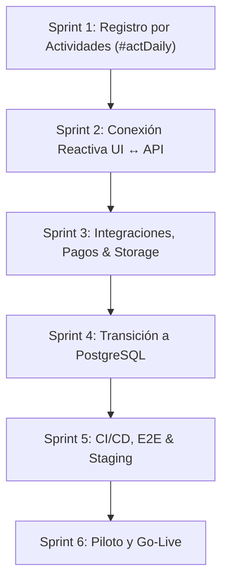

# Roadmap Maestro hacia Producción: MGH Timekeeping & Payroll

**Última actualización:** 8 de Octubre, 2026  
**Rama activa:** `desarrollo` (Commit base: `82d8315`)  
**Documento único y oficial de seguimiento.** Unifica el diagnóstico de producción original con el plan de integración de Carmen y las nuevas funcionalidades requeridas.

---

## 1. Estado Actual y Logros Consolidados (Dónde Estamos Hoy)

El repositorio cuenta con una base full-stack sólida, relacional y probada en la rama `desarrollo`:

- **Base de Datos y Persistencia Local:**
  - Sustitución completa del antiguo `db.json` por **SQLite relacional** (`backend/data/payroll.db`) con transacciones ACID, claves foráneas e índices.
  - Tablas operativas: `employees`, `pay_periods`, `adjustments`, `audit_logs`, `timesheets`, `attendance_punches`, `attendance_exceptions`, `leave_requests`, `holidays`, `organization_configs`.
- **Seguridad y Control de Acceso:**
  - Autenticación segura de contraseñas con **PBKDF2** (salt + hash) y sesiones revocables en SQLite.
  - Matriz **RBAC** con 9 roles corporativos y 38 permisos granulares.
  - Multi-tenancy / Multi-HQ: Soporte para organizaciones en **Dominicana**, **USA** y **UK** con monedas, husos horarios y reglas locales.
- **Motores de Cálculo y Reglas de Negocio:**
  - Motor fiscal multidivisa: **TSS + DGII ISR** (República Dominicana), **FICA + Federal withholding** (EE. UU.), **HMRC PAYE + NI** (Reino Unido), y Contratistas exentos.
  - Motor de Horas Extra configurable (`splitOT`: semanal > 44h, diario > 8h o combinado).
  - Workflow multinivel de 5 etapas para hojas de tiempo y aprobaciones de licencias.
- **Frontend y Experiencia de Usuario:**
  - Cascarón modular en Vite + React con suite completa de pantallas:
    - **Centro de Operaciones (`#ops`)**: KPIs ejecutivos, alertas de hojas > 48h y excepciones abiertas.
    - **Roles y Permisos (`#permissions`)**: Matriz de permisos corporativos y alcances jerárquicos.
    - **Módulo de Asistencia**: Dashboard (`#attendance`), Asistencia Diaria (`#attDaily`), Calendario (`#attCalendar`), Excepciones (`#attExceptions`), Licencias y Vacaciones (`#attLeave`), Feriados (`#attHolidays`), Reportes (`#attReports`) y Reglas (`#attRules`).
    - Selectores en la barra superior: Multi-HQ (DR/US/UK), Idiomas en vivo (`ES`/`EN`) y Persona Demo.
    - Pantalla corporativa de Login y protección 403 Forbidden (*Acceso Denegado*).
- **Calidad y Automatización:**
  - **18/18 pruebas automatizadas aprobadas (100%)** con Node Test Runner.
  - Build de producción frontend (`npm run build`) validado y libre de errores de compilación.

---

## 2. Matriz de Progreso General

| Fase | Descripción | Estado | Cobertura / Entregables Clave |
|---|---|:---:|---|
| **Fase 0** | Definición de Alcance y Producto | 🟢 Completado | Entidades DR/US/UK, 9 roles, flujos de aprobación y monedas. |
| **Fase 1** | Seguridad, RBAC y Sesiones | 🟢 Completado | PBKDF2, middleware auth, guard en UI, pantalla 403. |
| **Fase 2** | Persistencia Relacional SQLite & Auditoría | 🟢 Completado | Esquema SQLite, controladores desacoplados, log SHA-256. |
| **Fase 3** | Motor Fiscal y Reglas de Negocio | 🟢 Completado | ISR, FICA, PAYE, splitOT, validaciones numéricas exactas. |
| **Fase 4** | Integración Base de Pantallas (Carmen) | 🟢 Completado | Vistas en `kit.jsx`, módulos en `lib/`, 18 tests automatizados. |
| **Fase 5** | **Registro por Actividades (`#actDaily`) y Equivalencia** | 🟢 **Completado (Sprint 1)** | Menú desplegable, formulario Jira/evidencias, SQLite `daily_activities`, 21 tests. |
| **Fase 6** | Conexión Reactiva End-to-End de la UI a la API | 🟡 **En Curso (Sprint 2)** | Aprobación en vivo de timesheets, licencias y ponches sin estado local. |
| **Fase 7** | Integraciones Externas (Jira, Pagos, Storage) | 🔴 Pendiente (Sprint 3) | Sincronización real Jira Cloud, exportación ACH/BHD, almacenamiento evidencias. |
| **Fase 8** | Transición a DB Productiva (PostgreSQL/MySQL) | 🔴 Pendiente (Sprint 4) | Conector `src/db/` hacia PostgreSQL administrado. |
| **Fase 9** | CI/CD, Pruebas E2E y Entorno Staging | 🔴 Pendiente (Sprint 5) | GitHub Actions, tests E2E con Playwright, staging deploy. |
| **Fase 10** | Piloto y Lanzamiento a Producción | 🔴 Pendiente (Sprint 6) | Ciclo paralelo de nómina, aprobación Finanzas/HR, go-live. |

---

## 3. Roadmap Unificado: Lo Que Nos Falta a Partir de Ahora

> ### 📌 Regla de Oro Operativa: Commit Obligatorio por Tarea Completada
> **Acción estándar innegociable:** Cada vez que se complete una tarea o subtarea del listado:
> 1. **Validación técnica:** Ejecutar la verificación correspondiente (`npm test` para backend o `npm run build` para frontend).
> 2. **Actualización del checklist:** Marcar la casilla de la tarea en este documento como completada (`[x]`).
> 3. **Commit inmediato en Git:** Registrar los cambios de inmediato en Git con mensaje descriptivo bajo la convención *Conventional Commits* (ej. `feat(sidebar): ...`, `feat(activities): ...`, `test: ...`), garantizando trazabilidad paso a paso, historial limpio y protección total contra imprevistos o reinicios de máquina.



---

### 🚀 Sprint 1 (Inmediato): Módulo de "Registro por Actividades" (`#actDaily`) y Equivalencia con Registro por Horas (`#attDaily`)

> **Enfoque de diseño:** Arquitectura Frontend/Fullstack Senior (React + Vite + Design System / Tailwind CSS + Node/Express + SQLite).

#### 3.1.1 Premisa Clave de Arquitectura: Equivalencia Total de Jornada
Ambos métodos de registro son **totalmente válidos y computacionalmente equivalentes**:
- **Registro por horas (Reloj / Intervalos - `#attDaily`):** Fichaje con hora exacta de entrada, pausas y salida.
- **Registro por actividades (Entregables / Tareas - `#actDaily`):** Reporte de tiempo asignado a tareas específicas (ej. `2.5h` en Jira `MSH-214`), tipo de trabajo, descripción técnica y evidencias multimedia.

**Regla de unificación en el modelo de dominio:**
$$\text{Total Horas del Día} = \max\left(\sum \text{Duración de Ponches}, \sum \text{Horas de Actividades}\right) \quad \text{o suma complementaria según política}$$
Ambos métodos alimentan exactamente los mismos agregadores:
1. Meta de jornada diaria (ej. 8.0h / día).
2. Horas acumuladas de la quincena en la cabecera `timesheets`.
3. Cálculo de horas regulares vs. horas extra (`splitOT`).
4. Liquidación y recibos de pago en el motor de nómina (`payroll-engine.service.js`).

#### 3.1.2 Desglose de Tareas

##### Tarea 1.1: Navegación Desplegable en el Sidebar (Left Menu)
- [x] Localizar la sección de registro de jornada en el menú lateral izquierdo.
- [x] Convertirla en un menú desplegable interactivo (click o hover) con dos sub-opciones claras:
  1. **"Registro por horas"**: Redirige a la vista existente en `#attDaily`.
  2. **"Registro por actividades"**: Redirige a la nueva vista `#actDaily`.
- [x] Mantener compatibilidad con permisos RBAC (`attendance.view` / `timesheets.self`) y estado visual activo (`active`).

##### Tarea 1.2: Vista Principal "Registro por Actividades" (`#actDaily`)
- [x] **Header de Resumen Diario y KPIs:**
  - Selector de fecha con navegación (día anterior/siguiente / hoy).
  - Indicador de meta diaria (ej. `8.0h`), horas dedicadas registradas en actividades, horas restantes y barra de progreso dinámica con código de color (azul: en progreso, verde: meta cumplida, naranja: horas extra).
  - Botón principal de acción: `+ Registrar Actividad` (abre el panel modal / drawer).
- [x] **Timeline de Actividades del Día:**
  - Tarjetas interactivas con: ticket de Jira, badge de tipo de trabajo, horas dedicadas (`2.0h`), descripción técnica, chips de evidencias multimedia adjuntas y enlaces externos.
  - Botones de acción rápida: editar descripción, agregar evidencias o eliminar actividad con recálculo automático.
  - Estado vacío (*Empty State*) amigable con llamada a la acción para registrar la primera tarea.

##### Tarea 1.3: Formulario Modal / Drawer Deslizable "Registrar Actividad"
- [x] **Ticket de Jira Asociado:** Input selector con autocompletado y búsqueda rápida conectado al backlog de Jira (ej. `MSH-214: Implementación del backend...`, `ATLAS-412`).
- [x] **Dedicación y Tipo de Trabajo:**
  - **Duración dedicada:** Campo numérico flexible (`2.0`, `1.5`, `0.75`) sin obligar a definir horas exactas de reloj.
  - **Tipo de trabajo:** Selector desplegable tipado (*Desarrollo / Implementación*, *Pruebas / QA*, *Reunión técnica*, *Documentación / Arquitectura*, *Soporte / Hotfix*).
- [x] **Descripción del Avance:** Textarea amplio para documentar detalladamente el trabajo realizado, decisiones técnicas o resultados obtenidos.
- [x] **Zona de Evidencias Multimedia (Dropzone & Links):**
  - Dropzone visual drag-and-drop con soporte para imágenes (capturas de pantalla, UI, logs) y videos cortos (demos en MP4/WebM).
  - Campo para asociar enlaces externos clave (Pull Requests de GitHub/GitLab, links a Loom o documentación).
  - Lista previa de archivos agregados con miniatura, nombre, tamaño y botón para eliminar adjunto antes de guardar.
- [x] **Acciones del Formulario:**
  - Botón secundario: `Cancelar`.
  - Botón principal: `Guardar actividad` (valida campos requeridos, actualiza el resumen del día en tiempo real y persiste la entrada).

##### Tarea 1.4: Persistencia y API en Backend (`backend/`)
- [x] **Tabla SQLite `daily_activities` en [`schema.js`](file:///d:/GitHub/MHH-PAYROLL/backend/src/db/schema.js):**
  ```sql
  CREATE TABLE IF NOT EXISTS daily_activities (
    id TEXT PRIMARY KEY,
    employee_id TEXT NOT NULL,
    date TEXT NOT NULL,
    jira_key TEXT,
    jira_summary TEXT,
    hours REAL NOT NULL,
    work_type TEXT NOT NULL,
    description TEXT,
    evidences_json TEXT, -- [{ name, size, type, url }]
    links_json TEXT,     -- [{ label, url }]
    created_at DATETIME DEFAULT CURRENT_TIMESTAMP,
    FOREIGN KEY (employee_id) REFERENCES employees(id)
  );
  CREATE INDEX IF NOT EXISTS idx_activities_emp_date ON daily_activities(employee_id, date);
  ```
- [x] **Controlador `activities.controller.js`:** Listar actividades, registrar actividad con validación, y eliminar actividad con recálculo.
- [x] **Endpoints REST en `routes.js`:** `GET /api/activities`, `POST /api/activities`, `DELETE /api/activities/:id`.
- [x] **Sincronización en `timesheets`:** Actualizar automáticamente la cabecera quincenal garantizando que las horas de actividad sumen al balance del período.
- [x] **Cliente HTTP frontend en [`api.js`](file:///d:/GitHub/MHH-PAYROLL/frontend/src/lib/api.js):** Métodos `api.getActivities`, `api.createActivity`, `api.deleteActivity`.

##### Tarea 1.5: Pruebas y Criterio de Salida
- [x] Tests unitarios en backend verificando que el total de horas por actividades impacta `timesheets` de forma idéntica a los ponches.
- [x] Suite completa de tests (`npm test` con 21/21 pasando) en verde y build de Vite limpio.

---

### ⚡ Sprint 2: Conexión Reactiva End-to-End de la UI a la API (Fase 6)
*Objetivo: Erradicar el estado efímero en memoria y conectar todas las interacciones de usuario directamente a la base de datos relacional.*

- [x] **Aprobación de Timesheets en Vivo:**
  - Conectar los botones `Submit`, `Approve` y `Return` en `ApprovalWorkspace` (`#approvals`) con los endpoints `/api/timesheets/submit` y `/api/timesheets/approve`.
  - Exigir motivo de devolución obligatorio (*Return Reason*) persistido y auditado.
- [x] **Acciones de Asistencia y Licencias:**
  - Conectar el registro de ponches manuales en `#attDaily` a `api.post('/attendance/punch')`.
  - Conectar el modal de solicitud de vacaciones/licencias en `#attLeave` a `api.post('/leave/requests')`.
  - Conectar la resolución de excepciones en `#attExceptions` a `api.post('/attendance/exceptions/resolve')`.
- [x] **Gestión de Estados y Feedback:**
  - Sustituir mutaciones directas de arrays locales por estados de carga (*loading*), vacío (*empty*), error (*toast alert*) y éxito confirmados por el servidor.

---

### 🔌 Sprint 3: Integraciones Externas, Rails de Pago y Almacenamiento (Fase 7)
*Objetivo: Conectar el sistema con los servicios de infraestructura externos necesarios para operar.*

- [x] **Integración Real con Jira Cloud:**
  - Configuración OAuth 2.0 / API Token corporativo.
  - Sincronización incremental de worklogs y reporte de discrepancias entre horas estimadas y tiempo trabajado.
- [x] **Rails de Pago y Conciliación Bancaria:**
  - Generador de archivos bancarios **NACHA ACH** formal para empleados de EE. UU.
  - Formato de dispersión electrónica de nómina para **Banco BHD León** (República Dominicana).
  - Liquidación en criptoactivos (**USDC** sobre red Base / Coinbase) con almacenamiento del hash de transacción en la nómina.
  - Vinculación y descarga privada de comprobantes de pago emitidos (`paystub`).
- [x] **Almacenamiento Seguro de Evidencias Multimedia y Documentos:**
  - Separar los archivos adjuntos (evidencias de actividades, comprobantes de pago) de la base de datos (evitar URLs base64).
  - Implementar directorio local seguro (`backend/uploads/`) con tokens de acceso temporal, con arquitectura desacoplada para migración futura a AWS S3 o Google Cloud Storage.

---

### 🗄️ Sprint 4: Transición a Base de Datos Productiva Administrada (Fase 8)
*Objetivo: Migrar la persistencia local de desarrollo hacia un motor SQL corporativo robusto.*

- [x] **Adaptador de Base de Datos Desacoplado:**
  - Diseñar interfaz unificada en `backend/src/db/` que permita alternar entre `sqlite` (desarrollo local) y `pg` (PostgreSQL administrado para staging y producción) mediante variable `DATABASE_CLIENT`.
  - Preservar intactos los controladores (`employees`, `timesheets`, `activities`, `payroll`) sin acoplamiento a sintaxis propietaria.
- [x] **Migraciones Formales en PostgreSQL:**
  - Crear scripts de migración versionados.
  - Validación de tipos de datos de alta precisión (`DECIMAL(12,2)` para cálculo monetario sin pérdida de centavos).

---

### 🛡️ Sprint 5: Pruebas E2E, CI/CD, Staging y Auditoría (Fase 9)
*Objetivo: Blindar el sistema con tuberías de integración continua y pruebas automatizadas de punta a punta.*

- [x] **Pipeline de CI/CD (GitHub Actions):**
  - Ejecución obligatoria en cada Pull Request: lint de código, `npm test` en backend y `npm run build` en frontend.
- [x] **Pruebas End-to-End (E2E con Playwright):**
  - **Flujo 1:** Empleado inicia sesión -> Registra actividad con evidencias en `#actDaily` -> Se totalizan horas en la hoja de tiempo -> Supervisor aprueba en `#approvals`.
  - **Flujo 2:** HR/Payroll corre el cálculo de nómina del período -> Se calculan deducciones fiscales exactas -> Se genera el archivo de dispersión bancaria.
- [x] **Despliegue a Staging:**
  - Configuración de entorno staging aislado con variables de entorno productivas (`.env.staging`).
  - Monitoreo de logs estructurados, trazas de auditoría append-only y gestión segura de secretos.

---

### 🏁 Sprint 6: Piloto y Lanzamiento a Producción (Fase 10)
*Objetivo: Puesta en marcha controlada con personal real.*

- [x] **Ciclo Piloto en Paralelo:**
  - Procesar un ciclo de nómina completo de dos semanas en paralelo con el sistema actual.
  - Auditoría y cotejo centavo a centavo de horas registradas, horas extra, retenciones de impuestos y montos netos pagados.
- [x] **Aprobación Formal (Sign-off):**
  - Firma de conformidad por Nómina, Finanzas y Cumplimiento Legal/Laboral.
- [x] **Habilitación Progresiva (Rollout):**
  - Apertura por etapas: Sede República Dominicana primero, seguido de EE. UU. y Reino Unido.

---

## 4. Definición de "Listo para Producción" (Criterios de Aceptación)

El sistema se considerará formalmente apto para operar cuando cumpla los siguientes 6 pilares:

1. **Zero Mock Data:** Ninguna pantalla ni botón simule operaciones en memoria ni dependa de `localStorage`.
2. **Equivalencia de Jornada Total:** El registro por horas (`#attDaily`) y el registro por actividades (`#actDaily`) converjan sin discrepancias en las hojas de tiempo y nómina.
3. **Cero Cálculos en Cliente:** Toda la matemática tributaria y salarial se ejecute en el backend con precisión decimal.
4. **Integridad Relacional y Auditoría:** Base de datos relacional con ACID y registro inmutable de auditoría para cada acción sensible.
5. **Seguridad y Permisos en Servidor:** Rutas de API blindadas con RBAC estricto y sesiones corporativas revocables.
6. **Pipeline Automatizado en Verde:** 100% de tests unitarios, de integración y E2E aprobados en el pipeline de CI.
