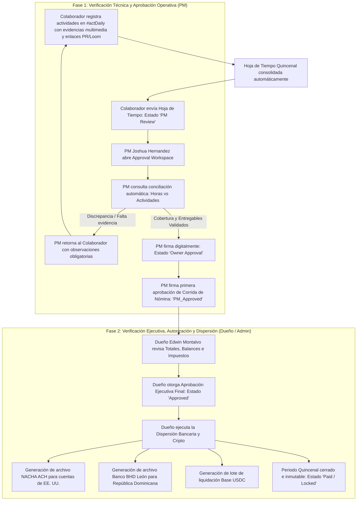

# Protocolo de Gestión de Horas y Doble Verificación en Pagos Quincenales

**Versión:** 1.0  
**Fecha:** 19 de Octubre, 2026  
**Estado:** Implementado y Validado en `desarrollo`  

---

## 1. Resumen Ejecutivo

El sistema de gestión de tiempos y nómina quincenal de **My Global Hub (MGH)** implementa un **protocolo de doble verificación estricta** antes de permitir la dispersión de fondos:

1. **Filtro 1 — Verificación Operativa (Rol: Project Manager / PM):**
   - El PM realiza una auditoría detallada de las **horas reportadas vs. las actividades y entregables** registrados por cada colaborador en el módulo `#actDaily`.
   - Verifica la cobertura horaria (`% Match`), las descripciones de tareas, tickets de Jira y las evidencias técnicas adjuntas (capturas de pantalla, commits/PRs de GitHub, videos Loom de testing).
   - Otorga la primera aprobación formal de la hoja de tiempo y de la corrida de nómina (`PM Review` ➔ `Owner Approval` / `PM_Approved`).

2. **Filtro 2 — Verificación Financiera y Dispersión (Rol: Dueño / Administrador):**
   - El Dueño / CEO (`role: admin`, Edwin Montalvo) realiza la revisión ejecutiva de la nómina consolidada (Total Bruto, Deducciones Fiscales TSS/ISR, Neto total por entidad).
   - Otorga la autorización ejecutiva final (`Approved`).
   - Es el **único rol autorizado** para emitir y ejecutar los desembolsos a través de rieles bancarios (archivos NACHA-ACH en USD, Banco BHD León en DOP, lotes Base USDC en criptoactivos) y generar el sellado criptográfico SHA-256 del periodo.

---

## 2. Diagrama de Flujo del Ciclo Quincenal

---

## 3. Arquitectura Técnica Implementada

### A. Base de Datos Relacional (`SQLite`)
- **`payroll_runs`**:
  - `pm_approved_by`: Registra el PM que auditó las actividades.
  - `pm_approved_at`: Marca temporal ISO de la revisión técnica.
  - `owner_approved_by`: Registra al Dueño que autorizó los pagos.
  - `owner_approved_at`: Marca temporal de la autorización financiera.
  - Estados: `'Draft'` ➔ `'Calculated'` ➔ `'PM_Approved'` ➔ `'Approved'` ➔ `'Paid'`.
- **`organization_configs`**:
  - `workflow_steps`:
    - Paso 1: `{ key: 'pm', label: 'PM Review', role: 'pm', review: 'PM Review' }`
    - Paso 2: `{ key: 'owner', label: 'Owner Approval', role: 'admin', review: 'Owner Approval' }`

### B. Endpoints de la API Backend
- `GET /api/timesheets/:id/reconciliation`:
  - Retorna el análisis día por día de horas de jornada vs actividades, porcentaje de cobertura (`matchPercentage`), horas de variación (`varianceHours`), cantidad de entregables, y estado del protocolo (`verificationProtocol`).
- `POST /api/payroll/runs/:id/pm-approve`:
  - Reservado para `role: pm` y `admin`. Valida y marca la pre-aprobación del PM.
- `POST /api/payroll/runs/:id/approve`:
  - Reservado para `role: admin` (Dueño) y Finanzas. Bloquea el periodo y habilita la dispersión bancaria.
- `POST /api/timesheets/:id/approve`:
  - Avanza secuencialmente el timesheet: `PM Review` ➔ `Owner Approval` ➔ `Approved`.

### C. Frontend (`React + Vite`)
- **`ApprovalWorkspace` (`frontend/src/kit/kit.jsx`):**
  - Integra en caliente la llamada `api.timesheetReconciliation`.
  - Muestra el banner del **Protocolo de Doble Verificación Quincenal** con badges de estado en vivo para el PM y el Dueño.
  - Muestra el porcentaje de cobertura y total de horas en actividades.
  - Botones contextuales según el paso activo:
    - *"Aprobar Actividades y Pasar a Dueño"* (Paso PM).
    - *"Aprobación Final de Dueño & Continuar"* (Paso Dueño).
    - *"Ejecutar Dispersión Bancaria & Marcar Pagado"* (Desembolso final).

---

## 4. Pruebas y Validación Automatizada

La suite automatizada en `backend/test/two_tier_verification.test.js` cubre:
- [x] Registro de actividades con evidencias por el colaborador.
- [x] Envío y transición inmediata a `PM Review`.
- [x] Conciliación matemática exacta (100% cobertura, 0 horas de variación).
- [x] Aprobación técnica del PM avanzando la hoja a `Owner Approval`.
- [x] Aprobación ejecutiva del Dueño avanzando a `Approved`.
- [x] Registro en base de datos de firmas `pm_approved_by` y `owner_approved_by`.
- [x] Todas las pruebas E2E aprobadas en consola sin regresiones.
