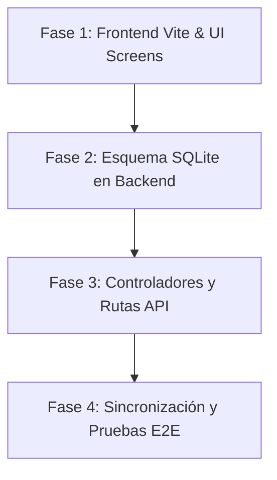

# Plan Maestro de Integración: Mejoras de Carmen + Backend MGH Timekeeping

> **NOTA DE UNIFICACIÓN:** Este documento ha sido unificado con el plan de producción general en el documento oficial: **[`PLAN-PRODUCCION.md`](file:///d:/GitHub/MHH-PAYROLL/PLAN-PRODUCCION.md)** (*Roadmap Maestro hacia Producción: MGH Timekeeping & Payroll*), el cual actúa como la **única fuente de verdad** del proyecto para todas las fases, requerimientos y sprints futuros.

**Fecha de creación:** 7 de Octubre, 2026  
**Rama:** `desarrollo`  
**Objetivo:** Integrar todas las nuevas características y pantallas desarrolladas por Carmen (`carmen zip/`) en la arquitectura full-stack profesional del proyecto (`frontend/` con Vite + React y `backend/` con Express + SQLite + Sesiones).

---

## 1. Diagnóstico y Análisis Comparativo

### 1.1 Aportes de Carmen en `carmen zip/`
- **Motor de Permisos y Tenancy (`app/rbac.js`):**
  - 9 roles corporativos (`Platform Admin`, `Org Admin`, `HR`, `Payroll`, `CFO`, `Manager`, `Supervisor`, `Employee`, `Contractor`).
  - Matriz central de 38 permisos granulares.
  - 6 niveles de alcance jerárquico (`self`, `team`, `department`, `project`, `organization`, `global`).
  - Separación de organizaciones (Multi-HQ: `Dominicana`, `USA`, `UK`) con monedas, husos horarios y reglas locales.
  - Pantalla dedicada de Roles y Permisos (`#permissions`).
- **Motor de Asistencia Completo (`app/attendance.js` y `ScreensAttendance.jsx`):**
  - 8 submódulos integrados por pestañas:
    1. Dashboard de Asistencia (`#attendance`)
    2. Asistencia Diaria (`#attDaily`)
    3. Calendario Mensual / Semanal (`#attCalendar`)
    4. Excepciones Automáticas (`#attExceptions`): Faltas de ponches, tardanzas, salidas tempranas, horas extra.
    5. Solicitudes de Licencia y Vacaciones (`#attLeave`): 8 tipos de licencia con flujo de aprobación Supervisor → HR.
    6. Feriados Oficiales (`#attHolidays`): Días no laborables por país (República Dominicana, EE. UU., Reino Unido).
    7. Reportes de Asistencia (`#attReports`): Exportables en CSV/PDF/Excel.
    8. Reglas de Asistencia (`#attRules`): Turnos, margen de tolerancia (grace period), pausas automáticas.
- **Motor de Workflow Configurable y Horas Extra (`app/workflow.js`):**
  - Flujo de aprobación multinivel configurable de 5 etapas (`Employee` → `Supervisor` → `Manager` → `HR/CFO` → `Payroll`).
  - Reglas de Horas Extra (OT) por organización: Semanal (> 44h), Diario (> 8h), Ambos o Personalizado (`splitOT`).
  - Transiciones de estado auditadas con motivo de devolución obligatorio.
- **Centro de Operaciones (`#ops` en `app/kit.jsx`):**
  - Tablero de control ejecutivo con KPIs en vivo, alertas priorizadas (hojas > 48h, excepciones abiertas), salud del sistema y registro de auditoría.
- **Internacionalización en Vivo (`app/i18n.js` y `#languages`):**
  - Soporte dinámico para Español (idioma base) e Inglés con selector instantáneo en la barra superior.
- **Protección de Rutas (403):**
  - Pantalla amigable de Acceso Denegado (403 Forbidden) cuando el rol del usuario no tiene permisos sobre la página.

### 1.2 Brecha vs Nuestro Backend Actual
En el prototipo de Carmen:
- Toda la persistencia dependía de `localStorage` y memoria en navegador (sin base de datos).
- No existía autenticación real, hash de contraseñas ni sesiones revocables.
- Los módulos de asistencia, feriados, licencias y workflows no tenían API ni tablas en servidor.

En nuestro backend:
- Contamos con base de datos relacional SQLite con ACID y foreign keys.
- Sesiones corporativas seguras (PBKDF2 + sesiones revocables en SQLite).
- Motor fiscal preciso al centavo (DGII ISR + TSS, IRS W-4, HMRC PAYE, Contratistas exentos).
- Registro de auditoría inmutable SHA-256.

---

## 2. Fases de Ejecución



### Fase 1: Modularización e Integración en Frontend (`frontend/src/`)
- [x] **Mover y adaptar módulos a `frontend/src/lib/`:**
  - `src/lib/i18n.js` (Internacionalización)
  - `src/lib/rbac.js` (Permisos y Multi-Org)
  - `src/lib/workflow.js` (Workflow de 5 etapas y Horas Extra)
  - `src/lib/attendance.js` (Motor de Asistencia, Licencias y Feriados)
- [x] **Actualizar [`frontend/src/kit/kit.jsx`](file:///d:/GitHub/MHH-PAYROLL/frontend/src/kit/kit.jsx):**
  - Incorporar componentes de Carmen: `Operations`, `Permissions`, `Attendance` (con las 8 sub-vistas).
  - Incorporar mejoras en `ApprovalWorkspace` (motivo de rechazo, firma electrónica).
- [x] **Actualizar Cascarón en [`frontend/src/App.jsx`](file:///d:/GitHub/MHH-PAYROLL/frontend/src/App.jsx):**
  - Registrar nuevas rutas en `KIT`: `ops`, `permissions`, `attendance`, `attDaily`, `attCalendar`, `attExceptions`, `attLeave`, `attHolidays`, `attReports`, `attRules`, `languages`.
  - Integrar selector de organización (`Dominicana`, `USA`, `UK`), selector de idioma (`ES`/`EN`) y selector de demo persona en la barra superior.
  - Implementar renderizado de pantalla **403 Acceso Denegado** (`isDenied`).
  - Preservar el **Guard de Login Corporativo** y la integración con la API.
- [x] **Verificación de build:** Validar que `npm run build` o Vite transpile sin errores (Completado: 0 errores).

### Fase 2: Extensión de Base de Datos SQLite (`backend/src/db/`)
- [x] **Nuevas tablas en `schema.js`:**
  - `timesheets`: Cabecera de hojas de tiempo por empleado y ciclo, estado de workflow y desglose de horas.
  - `attendance_punches`: Registros diarios de ponches (in, lo, li, out, modo, autoLunch).
  - `attendance_exceptions`: Detección y resolución de anomalías de asistencia.
  - `leave_requests`: Solicitudes de vacaciones y licencias médicas/personales.
  - `holidays`: Días feriados oficiales por país y organización.
  - `organization_configs`: Configuración de etapas de workflow y reglas de horas extra por empresa.
- [x] **Semillas en `seeder.js`:**
  - Poblar feriados de 2025 para DR, US y UK.
  - Poblar solicitudes iniciales de licencia y excepciones de asistencia.

### Fase 3: Controladores y Endpoints API en Backend (`backend/src/controllers/`)
- [x] **`attendance.controller.js`:** Resumen de asistencia, listado diario, registro de ponches y resolución de excepciones.
- [x] **`leave.controller.js`:** Solicitud de licencia y aprobación multinivel (Supervisor / HR).
- [x] **`workflows.controller.js`:** Configuración dinámica de etapas y parámetros de horas extra.
- [x] **`timesheets.controller.js`:** Envío, aprobación y devolución de hojas de tiempo.
- [x] **`routes.js` & `api.js`:** Rutas Express y métodos cliente HTTP expuestos.
- [x] **`bootstrap` enriquecido:** Carga inicial automática de organizaciones, feriados, licencias, ponches y excepciones.

### Fase 4: Pruebas Automatizadas y Validación
- [x] **Tests automatizados (`npm test`):**
  - Validar motor de horas extra `splitOT` bajo reglas semanal y diaria.
  - Validar flujo de solicitudes de licencia y transiciones de estados de hojas de tiempo.
  - Validar ponches y resolución de excepciones de asistencia.
  - Validar endpoints HTTP en Express y payload de bootstrap.
  - **Resultado:** 18/18 pruebas aprobadas (100% éxito en commit `82d8315`).
- [x] **Build de producción frontend (`npm run build`):**
  - **Resultado:** Empaquetado limpio sin advertencias de sintaxis en Vite (dist generado satisfactoriamente).

---

## 3. Estado Actual y Pendientes para Retomar (Post-Reinicio)

### 3.1 Lo que está consolidado y asegurado
- Rama `desarrollo`, commit `82d8315`: backend relacional SQLite, controladores de asistencia/tiempos/licencias, rutas Express, modularización en `frontend/src/lib/` y registro en el cascarón de rutas de `App.jsx`.
- 18 pruebas automatizadas pasando con Node Test Runner.
- Base de datos local inicializada e íntegra.

### 3.2 Tareas pendientes de conexión en caliente (Fases previas)
- [ ] **Enlace reactivo directo a la API en pantallas de Carmen:** Conectar acciones que aún mutan estado local (como el formulario de solicitud de licencias en `#attLeave` o el registro manual de ponches) a los endpoints creados en `api.js` (`api.postPunch`, `api.createLeaveRequest`).
- [ ] **Aprobación de Timesheets en vivo:** Conectar los botones de acción en `ApprovalWorkspace` (`#approvals`) con `api.post('/timesheets/submit')` y `api.post('/timesheets/approve')`.
- [ ] **Levantamiento de dev servers:** Iniciar `npm run dev` para validar visualmente la experiencia de usuario y flujo multi-rol.

---

## 4. Fase 5: Módulo de "Registro por Actividades" (`#actDaily`) y Equivalencia con Registro por Horas (`#attDaily`)

> **Rol de diseño:** Desarrollador Frontend / Fullstack Senior (React + Vite + Design System / Tailwind CSS + Node/Express + SQLite).

### 4.1 Premisa Clave de Arquitectura: Equivalencia Total de Jornada
Ambas formas de registrar la jornada de trabajo son **totalmente válidas y computacionalmente equivalentes**:
- **Registro por horas (Reloj / Intervalos - `#attDaily`):** Bloques horarios estructurados con hora de entrada, pausas de almuerzo y salida (`punches.in`, `punches.out`).
- **Registro por actividades (Entregables / Dedicación - `#actDaily`):** Reporte de tiempo asignado a tareas específicas (ej. `2.5h` en Jira `MSH-214`), tipo de trabajo, descripción técnica y evidencias multimedia.

**Regla de unificación en el modelo de dominio:**
$$\text{Total Horas del Día} = \max\left(\sum \text{Duración de Ponches}, \sum \text{Horas de Actividades}\right) \quad \text{o suma complementaria según política}$$
Ambos métodos alimentan exactamente los mismos agregadores:
1. Meta de jornada diaria (ej. 8.0h / día).
2. Horas acumuladas de la quincena en la cabecera `timesheets`.
3. Cálculo de horas regulares vs. horas extra (`splitOT`).
4. Liquidación y recibos de pago en el motor de nómina (`payroll-engine.service.js`).

---

### 4.2 Desglose de Tareas de la Fase 5

#### Tarea 5.1: Navegación Desplegable en el Sidebar (Left Menu)
- [ ] **Reestructurar sección de Registro de Jornada en el menú lateral:**
  - Localizar el ítem de navegación "Asistencia diaria" / "Registro de horas".
  - Transformarlo en un submenú interactivo (dropdown o acordeón con estado colapsable en click/hover).
  - Incluir dos sub-opciones diferenciadas con iconos dedicados:
    1. **"Registro por horas"**: Redirige a la vista existente en `#attDaily` (fichaje por reloj / intervalos).
    2. **"Registro por actividades"**: Redirige a la nueva vista `#actDaily` (reporte por tareas y evidencias).
  - Preservar compatibilidad con el sistema de permisos RBAC (`attendance.view` / `timesheets.self`).
  - Indicar visualmente la ruta activa (`active`) tanto en el padre como en la opción hija seleccionada.

#### Tarea 5.2: Vista Principal "Registro por Actividades" (`#actDaily`)
- [ ] **Header de Resumen Diario y KPIs:**
  - Indicador de fecha con selector de día (`DatePicker` / navegación anterior/siguiente).
  - Meta del día (ej. `8.0h`), horas dedicadas registradas en actividades, horas restantes y barra de progreso porcentual dinámica con código de color (azul: en progreso, verde: meta cumplida, naranja: horas extra).
  - Botón principal de llamada a la acción: `+ Registrar Actividad` (abre el drawer/modal).
- [ ] **Listado / Timeline de Actividades del Día:**
  - Tarjetas interactivas por cada actividad registrada mostrando:
    - Chip con código y enlace del ticket de Jira (ej. `MSH-214`).
    - Tipo de trabajo (badge: *Desarrollo / Implementación*, *Pruebas / QA*, *Reunión técnica*, *Documentación*).
    - Horas dedicadas en formato destacado (`2.0h`).
    - Descripción del trabajo realizado.
    - Miniaturas o chips de evidencias multimedia adjuntas (imágenes con preview modal, videos cortos reproducibles, links a GitHub PR / Loom).
    - Botones de acción rápida: editar descripción, agregar evidencias o eliminar actividad con confirmación.
  - Estado vacío (*Empty State*) amigable cuando no hay actividades en la fecha seleccionada, guiando al usuario a registrar su primera tarea o conmutar al registro por horas.

#### Tarea 5.3: Formulario Modal / Drawer Deslizable "Registrar Actividad"
- [ ] **1. Ticket de Jira Asociado:**
  - Input selector con autocompletado y búsqueda en tiempo real conectado al backlog de Jira (ej. `MSH-214: Implementación del backend...`, `ATLAS-412: Optimización de GraphQL`).
  - Capacidad de ingresar una clave manual o tarea interna no listada.
- [ ] **2. Dedicación y Tipo de Trabajo:**
  - **Duración dedicada:** Campo numérico flexible (`2.0`, `1.5`, `0.75`) sin forzar horarios de inicio ni fin de reloj.
  - **Tipo de trabajo:** Selector desplegable con opciones tipadas:
    - *Desarrollo / Implementación*
    - *Pruebas / QA*
    - *Reunión técnica*
    - *Documentación / Arquitectura*
    - *Soporte / Hotfix*
- [ ] **3. Descripción del Avance:**
  - Textarea con auto-expansión y placeholder guía para documentar qué se construyó, decisiones técnicas, PRs asociados o blockers resueltos.
- [ ] **4. Zona de Evidencias Multimedia (Dropzone & Links):**
  - Área visual drag-and-drop con soporte para:
    - Imágenes: capturas de pantalla de resultados, logs, Swagger/Postman, UI (`.png`, `.jpg`, `.webp`).
    - Videos cortos: demostraciones funcionales (`.mp4`, `.webm`).
  - Campo de texto para adjuntar enlaces externos: Pull Requests (GitHub/GitLab), grabaciones de Loom, tableros o documentación Notion/Confluence.
  - Lista previa de archivos agregados con:
    - Miniatura / icono de tipo de archivo.
    - Nombre del archivo y tamaño formateado (ej. `2.4 MB`).
    - Botón de eliminación individual (`Trash / Remove`) antes del guardado.
- [ ] **5. Acciones y Validaciones:**
  - Botón secundario `Cancelar` (cierra sin guardar y limpia borradores).
  - Botón primario `Guardar actividad`:
    - Validación de campos requeridos (Ticket o título, duración > 0, descripción).
    - Actualización reactiva instantánea del total de horas del día en la UI.
    - Envío y persistencia al backend.

#### Tarea 5.4: Persistencia y API en Backend (`backend/`)
- [ ] **Esquema relacional en SQLite ([`backend/src/db/schema.js`](file:///d:/GitHub/MHH-PAYROLL/backend/src/db/schema.js)):**
  - Crear tabla `daily_activities`:
    ```sql
    CREATE TABLE IF NOT EXISTS daily_activities (
      id TEXT PRIMARY KEY,
      employee_id TEXT NOT NULL,
      date TEXT NOT NULL,
      jira_key TEXT,
      jira_summary TEXT,
      hours REAL NOT NULL,
      work_type TEXT NOT NULL,
      description TEXT,
      evidences_json TEXT, -- [{ name, size, type, url }]
      links_json TEXT,     -- [{ label, url }]
      created_at DATETIME DEFAULT CURRENT_TIMESTAMP,
      FOREIGN KEY (employee_id) REFERENCES employees(id)
    );
    CREATE INDEX IF NOT EXISTS idx_activities_emp_date ON daily_activities(employee_id, date);
    ```
- [ ] **Controlador `activities.controller.js`:**
  - `listActivities(req, res)`: Consultar actividades por empleado y rango de fechas.
  - `createActivity(req, res)`: Validar, registrar actividad y actualizar total de horas en la cabecera `timesheets`.
  - `deleteActivity(req, res)`: Eliminar actividad y recalcular horas del período.
- [ ] **Rutas API en `routes.js`:**
  - `GET /api/activities?employeeId=...&date=...`
  - `POST /api/activities`
  - `DELETE /api/activities/:id`
- [ ] **Actualización del cliente HTTP frontend ([`frontend/src/lib/api.js`](file:///d:/GitHub/MHH-PAYROLL/frontend/src/lib/api.js)):**
  - Métodos `api.getActivities(empId, date)`, `api.createActivity(payload)`, `api.deleteActivity(id)`.

#### Tarea 5.5: Validación, Pruebas y Criterio de Salida
- [ ] **Pruebas unitarias backend:**
  - Test de equivalencia: comprobar que 8 horas registradas por actividades impactan `timesheets` igual que 8 horas de ponches.
  - Test de validación de entradas de actividades y eliminación con recálculo.
- [ ] **Pruebas de compilación:**
  - `npm test` con todas las suites en verde.
  - `npm run build` sin errores en frontend.

